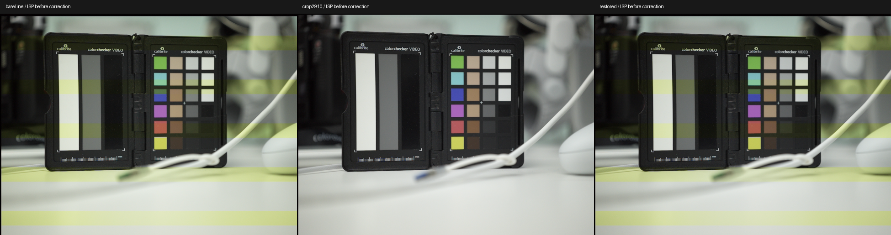

# 预览取样修复：实机验证

2026-10-15，X2D II v1.3.16.2，现有20261014zm/zl扩展。用户现场确认：“修好了”。

## 原设置 → 修正 → 恢复原设置

三组均取自 CPU 颜色补偿之前的原生 NV12。同一开机周期、相同 AV32/TV68/SV48 和手动对焦；自动白平衡有小幅漂移，未宣称锁定白平衡。

白色条的固定ROI，以行中位数拟合二次照明项和条带项，Cb周期偏移分别是 **−19.234、+0.016、−19.402**。恢复原设置后色带复现；再次进入实验设置仍消除粗带。ROI和模型记录在 [band-metrics.json](band-metrics.json)。该数值只评价该ROI及原周期，不代表全画面、全部光照条件或绝对色准验收。

## 录制与恢复

| 独立短录 | 输出 | 帧数 | 丢帧 / lost | 错误 |
| --- | --- | --- | --- | --- |
| H.264 | 1300×970，24fps | 129 | 0 / 0 | 0 |
| ProRes RAW | 3888×2912，24fps | 131 | 0 / 0 | 0 |

两个短录均正常停止。H.264 MP4回读可解码，图像不再有原粗色带。ProRes RAW写入峰值12ms。本轮没有做 RAW＋H.264 同时录制证明，也没有重新验证 RAW 色彩标定；短录数据见对应 `*-clip.json`。

正式构建 `782d559481ea0b9703a75eb850cf88548eb4ca17044d95691ea6a46886bb57a6` 已在实机加载：同一帧的2234880有效NV12字节在 CPU处理前后完全相同。普通预览的旧补偿耗时读数从本轮基线8850µs降为0；这不等于整机CPU占用测试。

主机几何检查确认 RAW 字节不变、预览窗口在输入范围内、重复应用被拒绝且不继续修改输入。构建链接/导出检查及 `git diff --check` 通过。

最终修复库已选用，实机 `idle`、`error=0`、ISP实时取景正常，保活已确认；原启动配置有回滚备份。安装记录见 [installed.json](installed.json)。启动选择已持久保存，但尚未进行重启验收。

## 解释边界

证据将可操作修复点定位到预览几何/取样组合，支持纵向缩放与源六行异常相互作用产生粗色带的解释。没有从周期直接推断PDAF，也没有读回硬件滤波tap的精确实现。预览裁掉源高度约1.22%，RAW录制尺寸不变。更高帧率、更多曝光/ISO及动态场景仍需单独验证。
